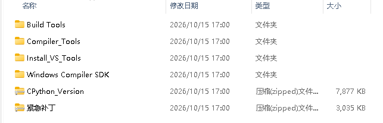
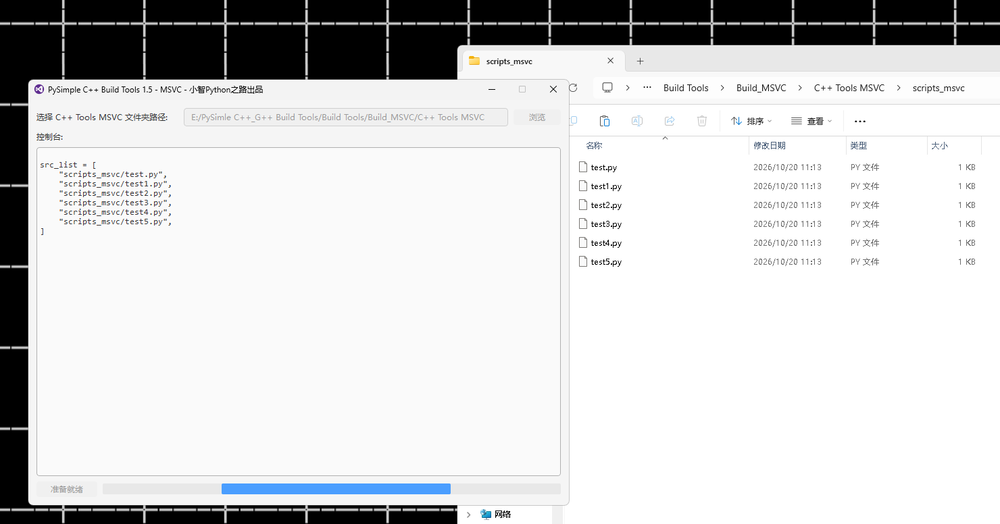
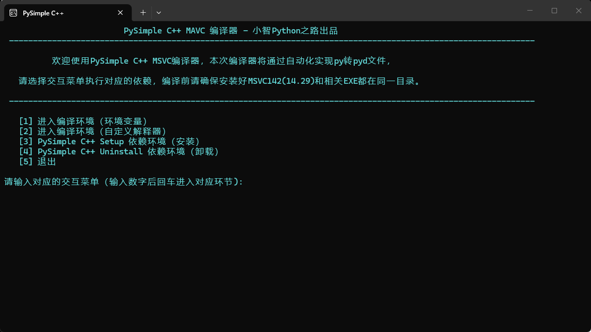
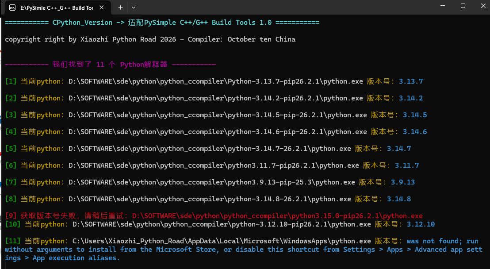
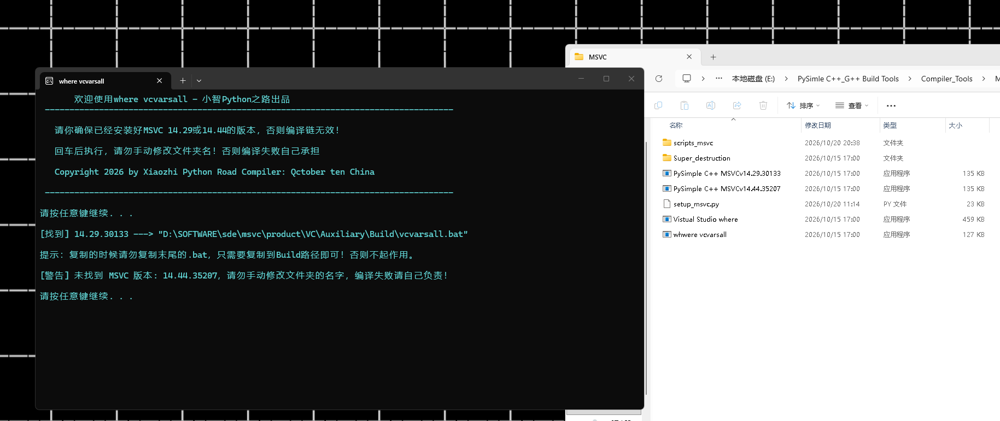
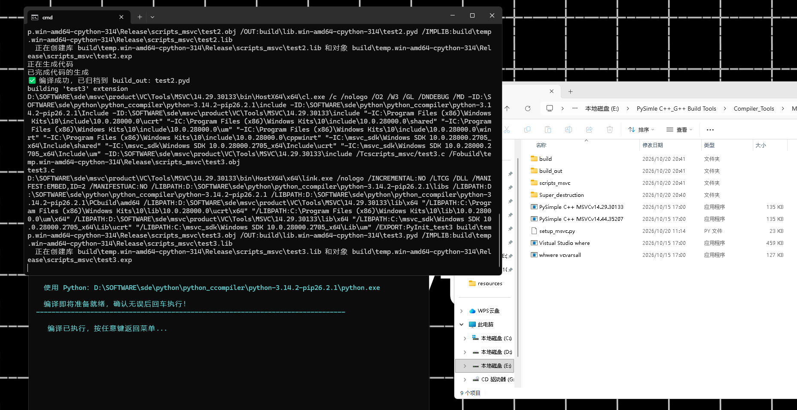
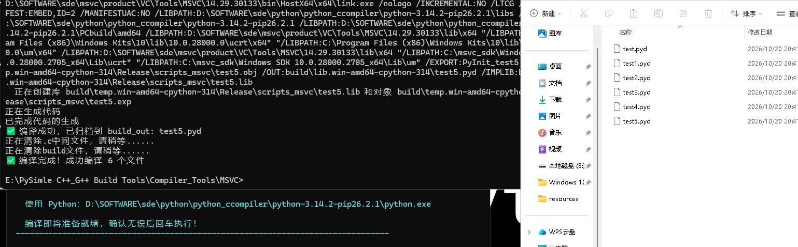

# Py Auto Pyd

## This is a fully automatic Py to Pyd conversion tool written based on Python Batch. We have encapsulated a minimalist interface for users to call up conveniently!

## Now let's start introducing these tools! Start

### Prepare the environment

### I. Tool Compiler

  We currently support all interpreters for Python version 3.8 and above. However, due to a serious defect, we are unable to support the newly released free thread-stable ABI of the Python 3.15.0 series without CIL. We have submitted a report on this issue. For more details, please visit  

[The detailed feedback issue page](https://github.com/python/cpython/issues/159457)

### Ii. System Platform：

Supports Windows 10 22H2 or Windows 11 25H2 and above systems  

### Iii. Toolset Environment：

### We support the Visual Studio C Build Tools/MinGW compiler. We complete the external completion pyd based on batch processing and can try it out of the box. Currently, cross-platform support is not supported. We are very sorry. Please forgive us because we have no experience with mac and Linux systems!  

We have completed the environment variable. The generation tool will support generating setup.py, so you don't need to write the code by hand. However, it should be noted that we currently only support it```MSVC(2019 installer(14.29v142)+MSVC（2022 installer 14.44v143(The MSVC142 working set needs to be selected)```However, there are also some special circumstances that you need to pay attention to

### Iv. Compiler Environment：

MSVC：To facilitate a statement: Without the Windows platform and MSVC, there would be no Windows version of CPython. Since version 3.5, the official version designated by MSVC has been used for compilation. You can compile your python interpreter within the range of MSVC we support

MinGW：GCC, also known as MinGW, was migrated from Linux to Windows. However, it has a drawback: it only supports interpreter versions 3.12 and above, and cannot compile interpreters 3.11 and below; otherwise, undefined errors for variables such as 401 and 407 will be thrown! But you can switch to the officially recommended MSVC

## Alright, my introduction is over. Now you can read the main text：

## The directory structure is as follows：


The most convenient part is that this tool encapsulates all the structures. Users only need to call them up, without having to write a single parameter command or code to achieve it! For setup.py, we have two sets of compiler generation tools to complete the conversion of py to pyd!


However, for libraries such as compilation, installation, and uninstallation, they are all handled here，

Currently, the compiler installation library only supports domestic mirror sites. If you are a foreign user, you can execute it manually``` pip install cython setuptools psutil```









Compiling pyd is this simple. If you also need this fully automatic conversion tool, you are welcome to submit your questions


